# Oberflächen-Review (15.10.2026)

Spur C, auf Wunsch des MENSCHEN („analysiere das Frontend … vergleich zu SOTA … sag, was
fehlt“; danach „Setze alle diese Punkte um“). Die Punkte stehen als C-41 bis C-59 in der
[Sammlung](../neuordnung/SAMMLUNG.md) (Abschnitt 3) und in [`OFFEN.md`](OFFEN.md). Hier
stehen Bewertung, Vergleich und die Soll-Bilder als Ziel für die Schritte.

## Aufnahme

App aus `dist/freedom.html` (frische Identität, Probe-Raum aus dem Smoke-Test), alle Seiten
und Unterreiter bei 1280 × 800 und 390 × 844; Website (Start, Whitepaper, FAQ, Roadmap,
Dashboard) ebenso. Ohne erreichbare Relays – Dashboard und Tauschen zeigen deshalb leere
Zustände. Die Noten sind eine begründete Einschätzung, kein Messwert.

## Bewertung (0–10)

| Bereich | Klarheit | Hierarchie | Platzierung | Mobil | Vertrauen | Ø | Vergleich |
|---|---|---|---|---|---|---|---|
| Start / Onboarding | 4 | 4 | 5 | 5 | 6 | 4,8 | Phantom, Signal, Primal |
| Agent | 5 | 4 | 3 | 3 | 5 | 4,0 | ChatGPT, Claude, Gemini |
| Chats (direkt) | 6 | 5 | 6 | 5 | 7 | 5,8 | Signal, WhatsApp, White Noise |
| Räume | 6 | 5 | 6 | 5 | 6 | 5,6 | Discord, Element X |
| Wallet | 4 | 4 | 4 | 4 | 6 | 4,4 | Phantom, Phoenix, Alby Go |
| Tauschen / Hinterlegen | 3 | 4 | 4 | 4 | 6 | 4,2 | Jupiter, Boltz |
| Verdienen | 4 | 4 | 5 | 5 | 6 | 4,8 | Salad, Akash Console |
| Repos | 6 | 5 | 6 | 5 | 6 | 5,6 | GitHub, gitworkshop.dev |
| Netz | 7 | 6 | 6 | 6 | 7 | 6,4 | Meshtastic-App |
| Profil | 4 | 4 | 5 | 5 | 3 | 4,2 | Primal, Damus |
| Einstellungen | 6 | 5 | 6 | 6 | 7 | 6,0 | iOS, Signal |
| Website Startseite | 5 | 4 | 5 | 4 | 5 | 4,6 | Signal.org, Proton, Phantom |
| Website Unterseiten | 6 | 4 | 5 | 5 | 6 | 5,2 | Stripe Docs, Proton |

App gesamt 5,1, Website 4,9; die Vergleichs-Apps liegen bei 8–9. Die Funktionen sind weiter
als bei der Konkurrenz, die Darstellung nicht.

**Behalten:** Checkliste „Sicherheit“, Liste „Mehr“ am Handy, Raum-Aufbau nach Discord,
Abdeckungskarte, Installer-Karte, Barrierefreiheit (C-4), ehrliche Texte, Akzentfarbe.

## Was fehlt – Reihenfolge

| Stufe | Schritte |
|---|---|
| sofort | C-41 Schlüssel per Klick · C-42 Schrift und Knöpfe · C-43 Führungsleiste · C-44 Avatare · C-45 leere Zustände · C-46 Agent-Kleinigkeiten · C-47 Namen · C-48 Website-Navigation |
| mittel | C-49 Agent-Eingabe · C-50 Wallet-Startseite · C-51 Tauschformular · C-52 Chat-Liste · C-53 Einstellungen · C-54 Verdienen · C-55 Onboarding |
| größer | C-56 Bausteine und Bildvergleich · C-57 helles Design · C-58 Website-Auftritt · C-59 Rückmeldungen |
| MENSCH | Kurzer Nutzertest (fünf Personen ohne Nostr-Vorwissen: erste Frage, Wallet verbinden, Freund anschreiben); Inter einbetten oder Systemschrift (`OFFEN.md` 1.3) |

## Soll-Bilder

HTML mit den Farben der App, gerendert mit Chromium – Richtung, keine Pixel-Vorgabe; Namen
und Beträge sind erfunden. Texte, die etwas versprechen, gelten nur, wenn der Code es hält
(Definition of Done 5).

| Agent (Desktop) | Agent (Handy) | Modell & Bezahlung |
|---|---|---|
| 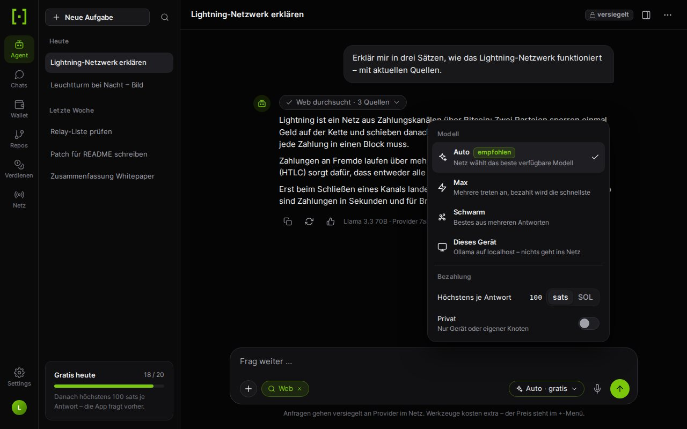 | 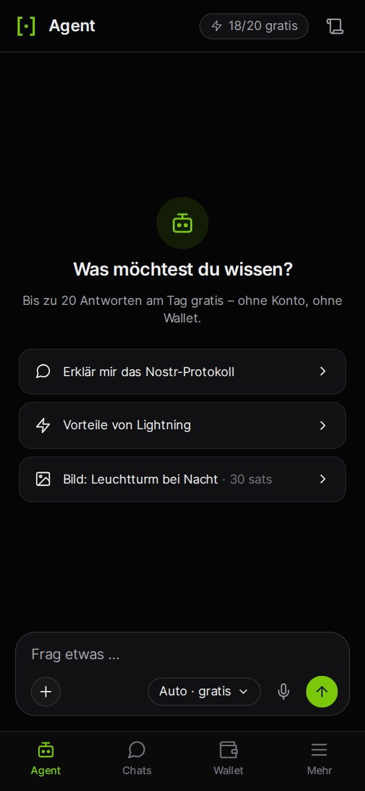 | 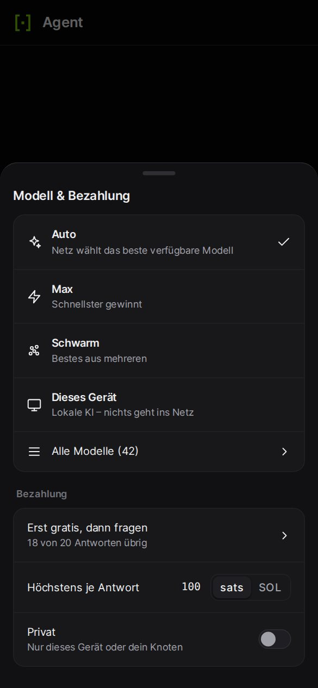 |

| Chats | Raum (Handy) | Profil (Handy) |
|---|---|---|
| 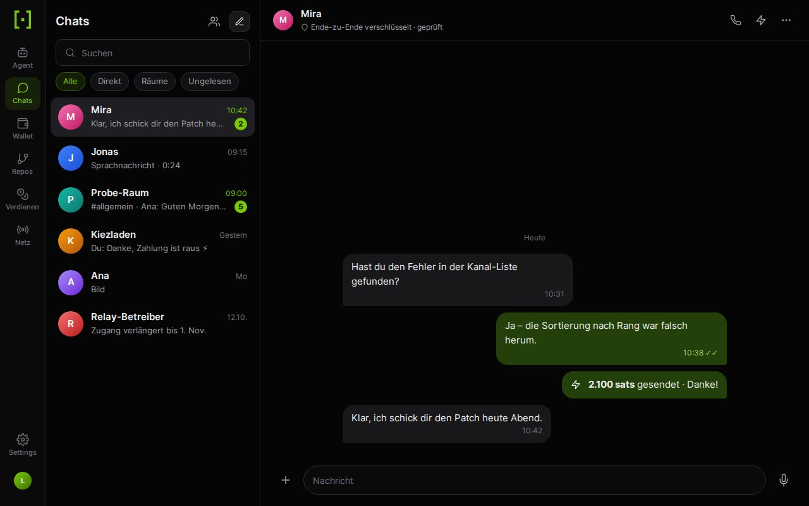 | 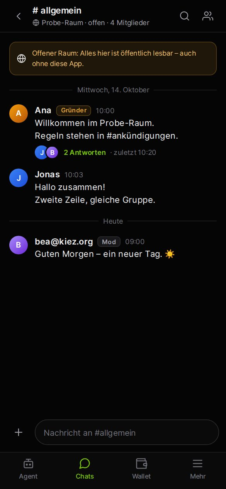 | 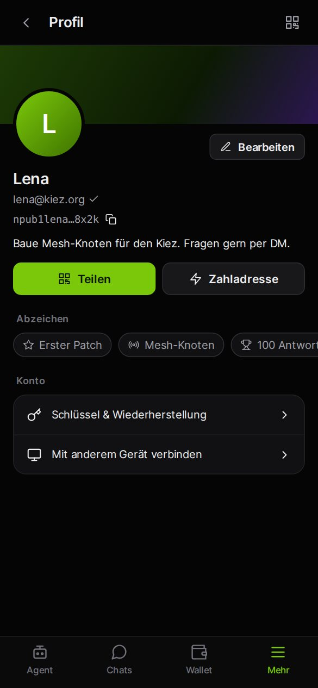 |

| Wallet | Wallet ohne Konto | Tauschen |
|---|---|---|
| 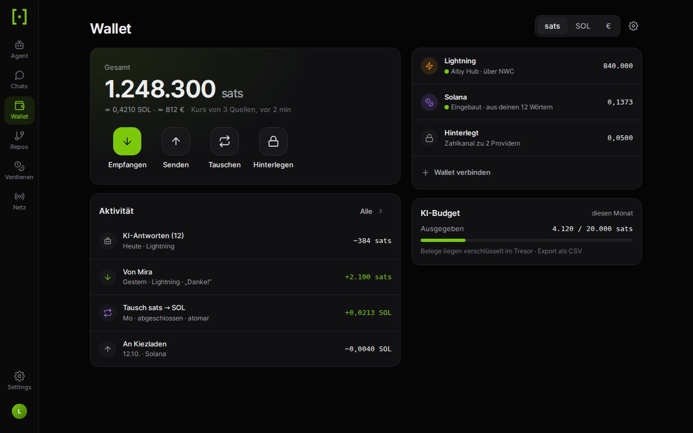 | 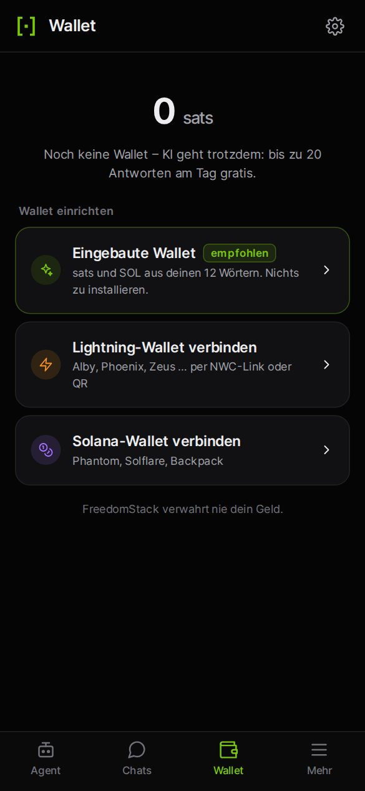 | 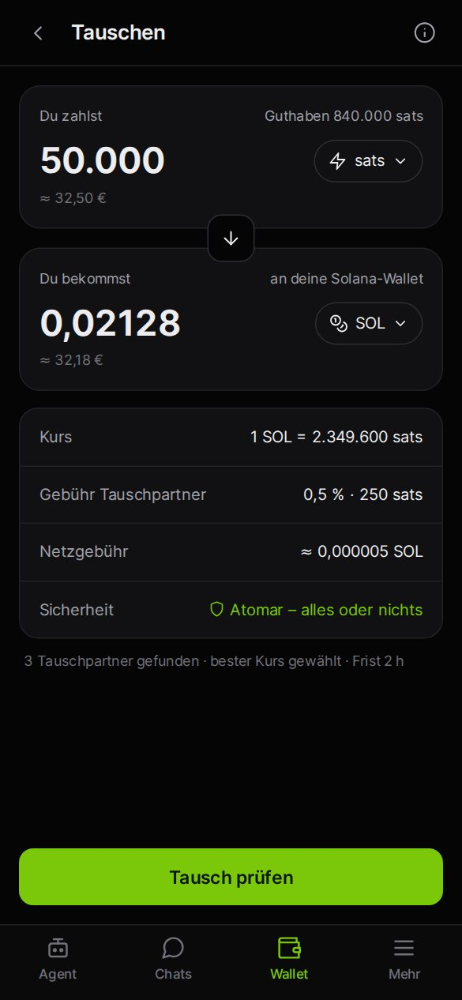 |

| Verdienen | Einstellungen › Netzwerk | Repos |
|---|---|---|
| 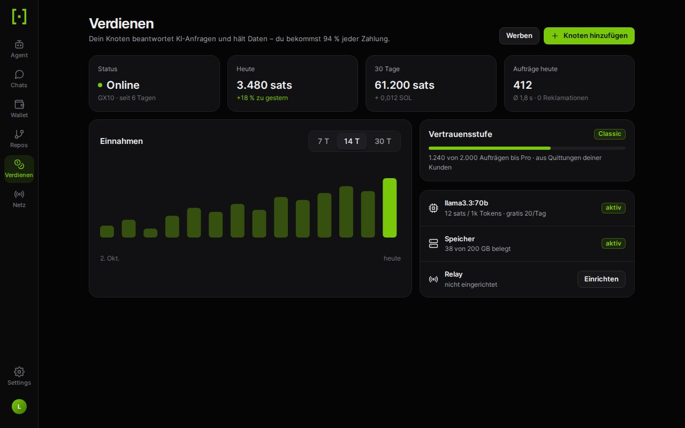 | 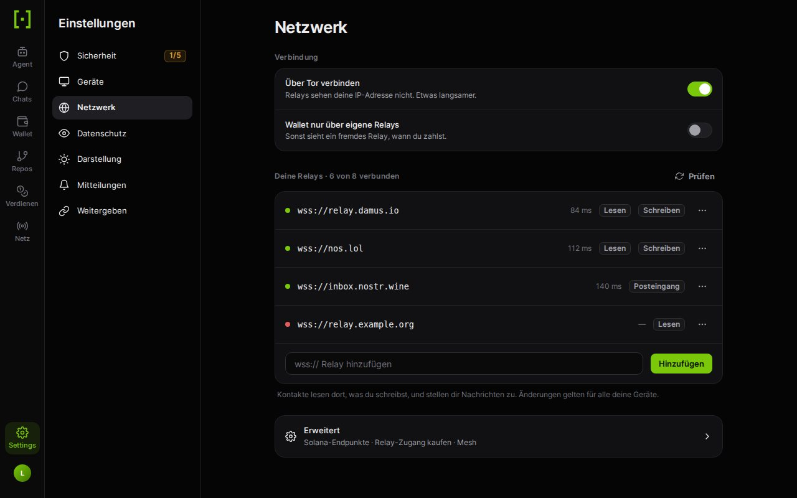 | 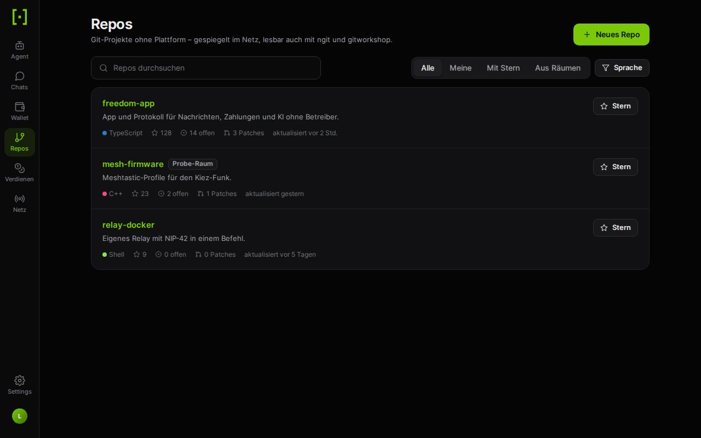 |

| Begrüßung | Wörter bestätigen | Website (Desktop) | Website (Handy) |
|---|---|---|---|
| 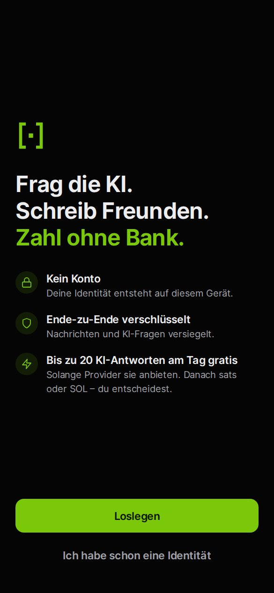 | 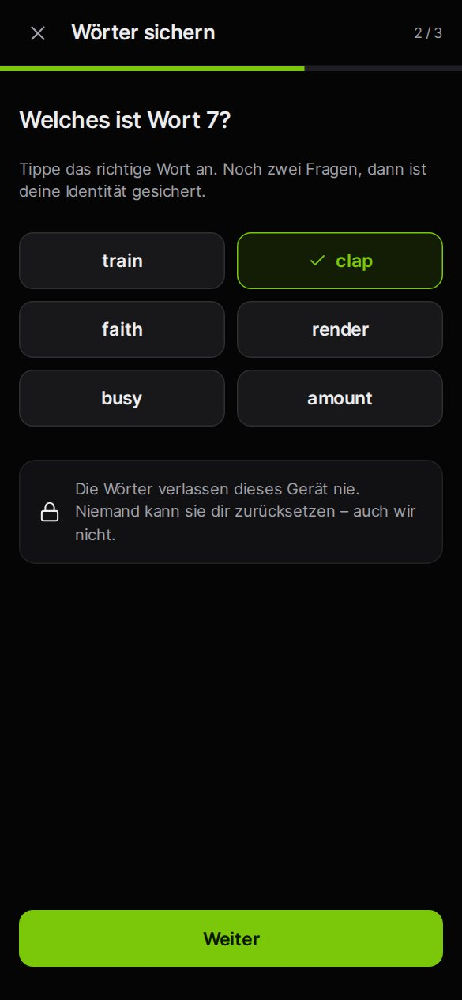 | 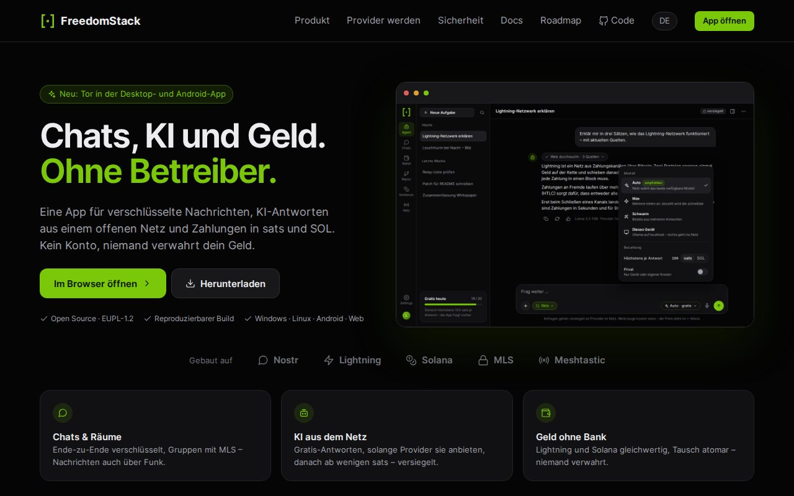 | 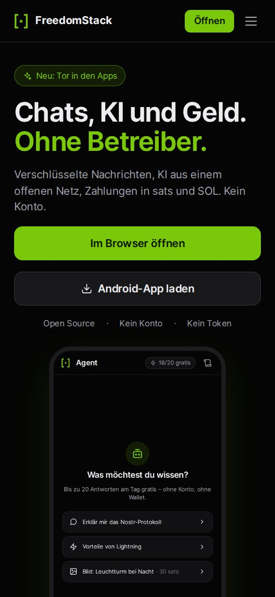 |
